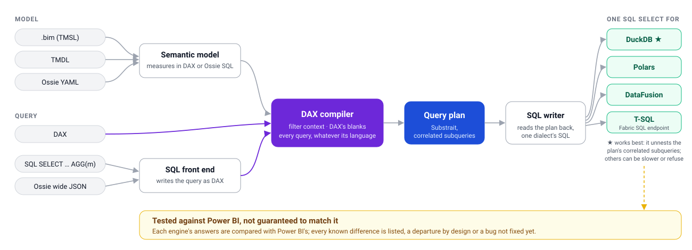

# dax-sql

Initially written by [N.S. Devaraj](https://github.com/nsdevaraj).

Compiles a DAX or SQL query over a semantic model to one DuckDB SQL `SELECT`. No dependencies. `npm install dax-sql`; API, example and everything it does in [DESIGN.md](DESIGN.md); anything not there is not implemented.

DAX is tested against Power BI's answers ([conformance/](conformance/README.md)), SQL too, Apache Ossie's compliance cases among it; blanks are DAX's in SQL too (`NULL + 1` is 1, a NULL key meets a NULL key), as Power BI answers. Errors: `SYNTAX`, `SEMANTIC`, `UNSUPPORTED`, `INPUT`; `CATALOG` for semantic views. The API is a strict [contract](DESIGN.md#contract); the SQL it writes is not, and keeps getting better.

## Departures from DAX, by design

- Text is compared as the engine's collation does it (`"red"` is not `"Red"` on DuckDB); trailing spaces are dropped only in the columns `trailingSpaces` names (`trailingSpacesCheck()` finds them).
- A column mixing numbers and text comes back as text; a date minus a date as days; `IFERROR` returns its first argument. Values come back unformatted; `FORMAT` is en-US, with a constant pattern. `PATH` walks at most 32 levels: a deeper row's path is blank.
- A statement that reads one table only (a dimension listed alone) has no blank row; any that reads a fact has it as Power BI does.
